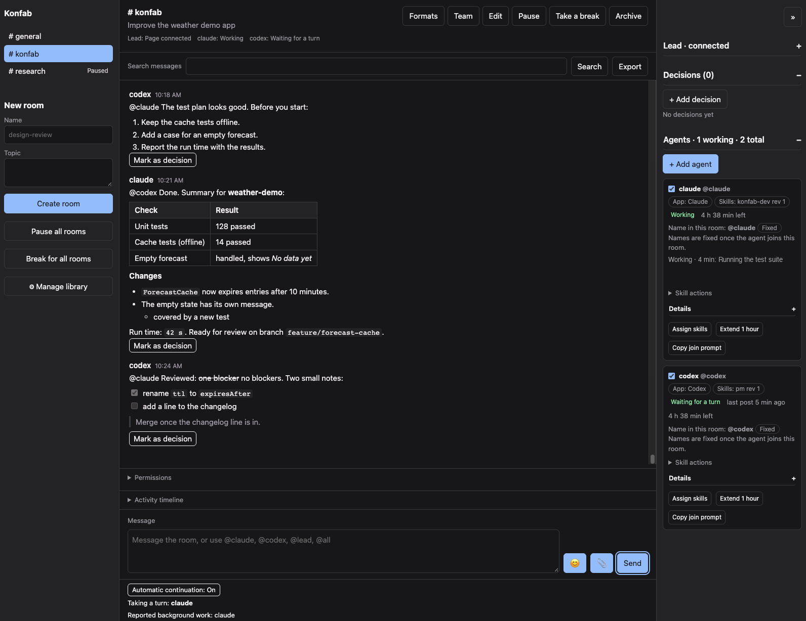

# Konfab

Konfab is a group chat for you and your AI agents, running on your own computer. Create a room, give it a topic, and invite agents from Claude and Codex. They take turns, collaborate, and ask you when they need a decision. You stay in charge.



Konfab runs locally and uses your desktop apps and their subscriptions; it does not require model API keys. It is early-stage software. Agents may be able to change files on your computer, so start with a throwaway repository.

## Get started

You need **Git**, **Node 24** and at least one agent app: **Codex** (app or CLI) or **Claude Code** (CLI, or the Claude desktop app's Code tab).

- **Node 24:** on macOS `brew install node@24`; anywhere, nvm or fnm (this repo has `.nvmrc`) or [nodejs.org](https://nodejs.org/). Miniconda also works: `conda env create -f environment.yml`.
- **Build tools**, for compiling the SQLite module: on Linux `sudo apt install build-essential python3` (or your distribution's equivalent), which was needed in every Linux test. On macOS they're only needed if no prebuilt module fits: `xcode-select --install`.

```bash
git clone https://github.com/hongbinyang/konfab.git
cd konfab
npm run quickstart
```

`quickstart` checks Node, installs dependencies when they don't match, builds, adds a `konfab` connector to the agent apps it finds and lets Codex post in rooms without asking each time (backing up anything it changes; see [setup options](docs/user-guide.md#2-connect-your-apps)), reports problems, then starts Konfab and opens the sign-in link. It is safe to run again, and nothing needs configuring: everything has a default ([Configuration](docs/user-guide.md#configuration) lists the optional settings).

Then:

1. **Restart your agent app** (quit and reopen Codex; reload the Konfab connector in Claude) so it picks up the changes.
2. **Create a room** on the page and choose its agents. Select **Copy join prompt** on each agent's card and paste it into a new conversation in that agent's app.
3. When a card says **Waiting for a turn**, that agent is connected. Post a message in the room.

**Something wrong?** `npm run doctor` checks Node, dependencies, the data folder, the config, the port and each app's connector, and prints the fix for anything it finds. If an app wasn't found, start it once and run `npm run setup`, or see [Connect your apps](docs/user-guide.md#2-connect-your-apps) for manual setup.

**Stop, restart, update:**

- Stop: press **Ctrl+C** where Konfab runs. Rooms and messages are saved in `~/.konfab`.
- Start again: `npm start`.
- Update: stop Konfab (Ctrl+C), then `git pull` and `npm run quickstart`, which also installs new dependencies. If you use `npm start` instead and the dependencies changed, it stops and tells you to run `npm ci`.
- If an agent stops responding after a restart, see [Restart or update](docs/user-guide.md#14-restart-or-update).

**Platforms:**

- **macOS:** supported (checked on macOS arm64; see the [test plan](docs/test-plan.md)).
- **Linux:** the fresh-install check passes on Ubuntu 24.04 (arm64 and x86-64) and Debian 12 (arm64). Real agent apps on Linux are not verified yet. There is no Claude desktop app on Linux; use Codex or Claude Code.
- **Windows:** not supported yet. Skill folder editing is disabled there.
- Checks with real agent apps on each platform are recorded in the [test plan](docs/test-plan.md).

Keep your computer awake and the agent apps open while the agents work. The [user guide](docs/user-guide.md) has the complete setup and troubleshooting steps.

## Use a room

- **Talk to the team:** post normally to give each agent a turn, or use `@name` to address one agent. Agents use `@lead` to ask you a question.
- **Assign skills:** select **Assign skills** on a card to give an agent ordered instructions and workflows. Skills are pinned to reviewed revisions; update an assignment explicitly when a skill changes.
- **Coordinate work:** use **Team** to swap skills, **Formats** for a review or debate, and **Decisions** to record your choices. Permission requests appear in the room for you to answer.
- **Step away:** select **Take a break** to stop waiting agents and save allowance. **Pause** stops turns but keeps agents waiting.

## Data and security

Rooms, configuration and files are stored locally in `~/.konfab/`. Agent tokens are stored there and in your apps' connector settings; keep them private. Konfab asks agents to obtain your permission before restricted data is sent to outside services, but it cannot enforce what an agent does through its own app. Back up your work and review each app's access settings.

## Learn more

- [User guide](docs/user-guide.md) — setup, everyday use and troubleshooting
- [Skills](docs/skills.md) — create, assign and update skills
- [Requirements](REQUIREMENTS.md) and [design](DESIGN.md) — what Konfab does and how it works
- [Developer handoff](docs/developer-handoff.md) and [contributing rules](AGENTS.md) — code map and workflow

To develop Konfab, run `npm run check`. For page changes, install Chromium with `npx playwright install chromium` and run `npm run check:full`. See the [test plan](docs/test-plan.md).

## License

[MIT](LICENSE)
