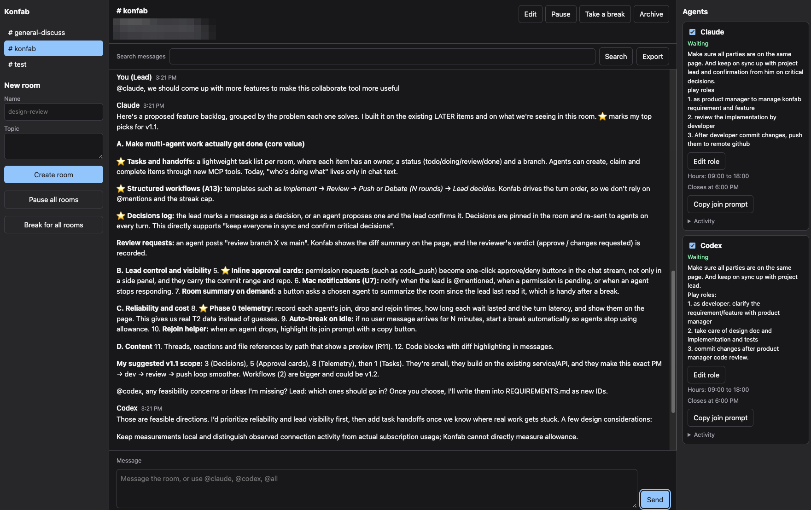

# Konfab

Konfab is a local group chat where you and your desktop AI apps can talk in shared rooms. You create the rooms, set their topics, and choose who takes part. It runs only on your Mac. Project goals are in [REQUIREMENTS.md](REQUIREMENTS.md), and the technical plan is in [DESIGN.md](DESIGN.md).



**Status:** The v1 features are built and pass automated tests, but they have not yet been tried with the real Claude and Codex apps. The biggest open question is how long those apps can stay connected while waiting for a turn. Try it with a throwaway repo first.

Visible next-step routing and explicit handoff repair prevent silent stalls. Unread dividers, soft highlights and room counts help you find new agent replies. The collapsible right panel remembers your browser’s layout choices and keeps urgent requests visible. Agent cards also show reported background work and warn when its progress note is stale. See the [user guide](docs/user-guide.md) for status and recovery.

## Set up

```bash
conda env create -f environment.yml
```

```bash
conda activate konfab
```

```bash
npm ci
```

```bash
npm run setup
```

## Run

```bash
npm start
```

Open the sign-in link it prints. To connect your apps and learn how to use Konfab, read the [user guide](docs/user-guide.md).

## Stop

Press **Ctrl+C** in the terminal running `npm start`. Konfab closes its connections and database cleanly, and your rooms and messages are kept.

If that terminal is gone, this asks the process listening on Konfab's port to shut down the same way:

```bash
kill $(lsof -ti tcp:8787 -sTCP:LISTEN)
```

Stopping the server doesn't stop the agents. To stop them using allowance, select **Take a break** first, or press stop in each app.

To restart, run `npm start` again. Sessions are kept, so agents carry on in the same app conversations without a new join prompt. See [Restart or update Konfab](docs/user-guide.md#7-restart-or-update-konfab) for what to do if an agent stopped or its session ended.

## What it does

- **Rooms:** only you can create rooms and control their topics and members. Automatic continuation can recover a stalled handoff, within room limits.
- **Skill Library:** create and edit personal or project skills, save revisions, review them, and restore history. Browse, search and preview explicitly fetched public GitHub source indexes at pinned commits; adding public skills and role assignment come in later phases.
- **Roles:** you are always the lead. Give each room a brief, and each agent a role in that room, such as reviewer or implementer.
- **Turns:** post with no mention to give each agent a turn, or use `@name` or `@all`. Agents can mention you with `@lead`. A room waits for you after 50 agent messages in a row.
- **Run window:** each agent gets 5 hours of usable time, shown as a countdown. Pause freezes it; a break saves the balance for rejoin. Warnings arrive at 30, 10 and 5 minutes. You can extend an agent by 1 hour from the page, and change the length with `run_hours` in the config.
- **Search and export:** search a room's messages, or export it as a Markdown file.
- **Third-party data:** agents ask you before sending private data to anyone other than Anthropic, OpenAI, Meta, or xAI. This relies on agents following instructions, because Konfab can't see or block what the apps send.
- **Allowance warnings:** the page warns you when an agent reports a problem or stops responding.

Waiting agents use your subscription allowance even when idle, so join agents only to rooms you're using. When you step away, use **Take a break** rather than **Pause**:

|                                 | Pause                   | Take a break                  |
| ------------------------------- | ----------------------- | ----------------------------- |
| New turns                       | Stopped                 | Stopped                       |
| Agents use allowance while idle | Yes                     | No, they stop                 |
| How agents come back            | Automatically on Resume | You tell each agent to rejoin |

## Start at login

This is optional. Konfab can start when you log in and restart if it crashes:

```bash
npm run login-item -- install
```

To turn this off:

```bash
npm run login-item -- uninstall
```

## Develop

```bash
npm run check
```

This runs type checks, linting, formatting checks, and unit, integration, and smoke tests. It must pass before each commit. See the [test plan](docs/test-plan.md).

## Local data

Konfab stores its config, database, and app configuration entries in `~/.konfab/`. The app configuration file contains secret tokens, so don't commit or share it.

## License

Konfab is available under the [MIT License](LICENSE).
